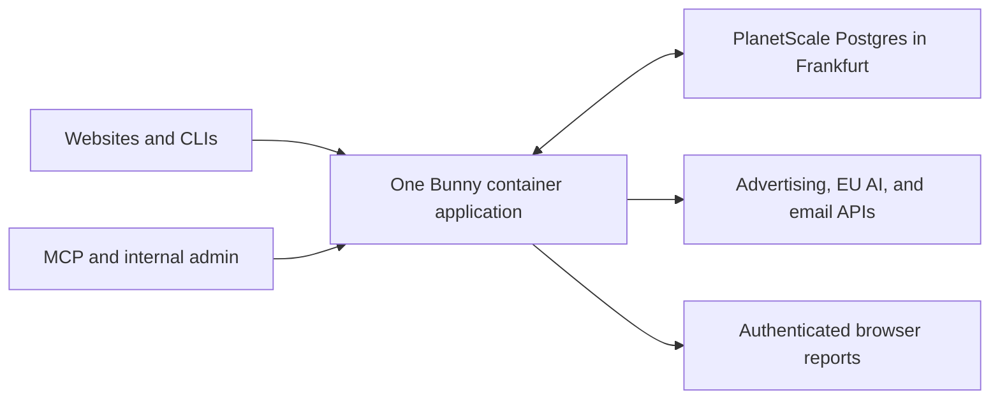

# Bunny and PlanetScale: feasibility, operations, cost, and portability

Assessment date: 2026-10-20. Product scope confirmed in Q45; see the
[product brief](analytics-service-brief.md). This is a source-backed design
assessment and arithmetic model, not a deployed prototype or capacity benchmark.
The initial PS-5 recommendation was replaced by the selected PS-10 starting
plan on 2026-10-20. See the [implementation plan](../plans/analytics-service.md).
No provider configuration, secrets, or subscriptions were changed.

## Recommendation

Start with one TypeScript application in Bunny Magic Containers, pinned to an
EU region, and ordinary PlanetScale Postgres in Frankfurt. Use the selected PS-10
single-node plan for the initial workload, subject to representative validation.
Keep HTTP collection, MCP, admin pages, browser reports, and a background work
loop in the same deployable application. Rust is also feasible in a container;
TypeScript is the simpler initial recommendation for the shared browser/MCP
surface, not a performance conclusion.

The initial forecast is approximately 1,000 pageviews per day. Treat this as the
portfolio total for calculation; the scope of that number has not been separately
confirmed. The former 200,000/day figure is a later planning ceiling, not the
launch workload. Portability is an explicit requirement: changing providers
should primarily affect deployment and integration configuration, rather than
the event model or application business logic.

## Why containers fit the whole service better than a pure edge script

| Option | Fit and operating tradeoff |
| --- | --- |
| Magic Containers + Postgres | One ordinary application can serve HTTP and run a work loop for reports, imports, expiry, and retries. Recommended initial shape. |
| Edge Scripting + Postgres | Collector and HTTP/MCP primitives are feasible, including HTTP SQL access. Durable scheduled execution still needs a proven trigger/runner; request-associated work is insufficient as a scheduling guarantee. |
| Edge collector + container worker | Available later if measured ingestion latency warrants a second deployment. The present workload does not justify that extra boundary. |

Edge Scripting documents JS/TS, 128 MB memory, 30 seconds of CPU per request,
and request-bound background continuation; native Rust server binaries are not
established there. Containers support standard linux/amd64 images. These are
provider capabilities, not tested application compatibility.
[Edge limits](https://bunny.net/docs/scripting/limits),
[background runtime](https://bunny.net/docs/scripting/runtime),
[container deployment](https://bunny.net/docs/magic-containers/deploy).

## Data and job design

Keep projects, permissions, consent choices, named events, campaign imports,
report snapshots, and durable job records in Postgres. Jobs have due times,
attempt state, and stable identities so a process restart can resume work and
retries do not blindly repeat completed work. A database-backed work loop avoids
requiring Redis or an additional queue service at launch. Multiple app replicas
would require coordinated job claiming and delivery deduplication.

Accept event batches only after committing their durable write. Use stable
batch/event identities for retry handling. Browser collection still has consent,
blocking, and network-related evidence gaps; a service cannot infer complete
visitor coverage from accepted requests alone.

Start with bounded payloads, tenant/time indexes, ordinary retention jobs,
and compact hourly/daily metrics. Aggregate dwell measurements rather than
emitting every movement or second as an event. Use summary queries and selected
journeys for AI analysis rather than sending every event to a model. Detailed
records remain available within the 90-day boundary. Time partitioning can be
introduced when measured volume warrants it; the initial workload does not
require a separate analytical database.

PlanetScale supports conventional Postgres connections and the Neon driver's
HTTP mode for individual queries/non-interactive transaction batches, with
WebSockets for interactive transactions. A container can use a conventional TLS
Postgres driver and a bounded pool. `pg_cron` and `pg_partman` are available, but
the core design need not depend on those optional extensions.
[Connections](https://planetscale.com/docs/postgres/connecting),
[HTTP driver](https://planetscale.com/docs/postgres/connecting/neon-serverless-driver),
[extensions](https://planetscale.com/docs/postgres/extensions).

## Initial data sizing

Assumptions: 30-day months; the pageview is included in total events per pageview;
512-1,024 persisted bytes per event including an approximate allowance for indexes.
These are sizing assumptions, not measured serialization or database sizes.

| Total events per pageview | Events per month | Events retained for 90 days | Detail data, before 30% headroom |
| --- | ---: | ---: | ---: |
| 5 | 150,000 | 450,000 | 0.23-0.46 GB |
| 15 | 450,000 | 1,350,000 | 0.69-1.38 GB |

Formula: `1,000 pageviews/day × 90 days × events/pageview × bytes/event`.
With 30% headroom the range is approximately 0.30-1.80 GB, before additional
CLI activity, the 24-month summary tables, report snapshots, and job/configuration
data. This makes the 10 GB included disk a reasonable starting candidate; it does
not prove that the selected 1 GB RAM or 1/8 vCPU meets every query and burst
requirement.

## Monthly cost at launch

All amounts are USD, before taxes. Provider rates were checked against official
docs and the live Frankfurt calculator. Estimates assume one always-running
small application and the initial workload, not the former ceiling.

| Item | Monthly amount | Evidence or assumption |
| --- | ---: | --- |
| PlanetScale PS-10 single node | $14 | Selected Frankfurt ARM configuration: 1 GB RAM, 1/8 vCPU, 10 GB disk; live calculator verified. |
| Bunny container and modest traffic | About $2-5 | Estimate using roughly 0.5-1 GB billed RAM and little CPU/traffic; actual overhead remains unmeasured. |
| Core app + database | About $16-19 | Sum of the preceding items; no HA or additional paid environments. |
| AI and email | Provider-dependent | Separate model/region/token and mail-service choices remain open. A small launch reserve is useful but is not a vendor quote. |

A provisional total planning envelope of **$25-40/month** is reasonable with a
small AI/email reserve, subject to those choices. It excludes development time,
paid ad spend, optional Shield plans, and any email/AI contract minimums that exceed
the reserve. If 1,000/day means per website, recalculate using the site count.
[PlanetScale calculator](https://planetscale.com/pricing?region=eu-central&engine=postgres&architecture=aarch64&replicas=0).

Bunny bills consumed CPU at $0.02/core-hour and used RAM at $0.005/GB-hour,
with rounding and platform overhead. At 720 hours, 0.5-1 GB of billed RAM alone
is $1.80-3.60. These are not reservation charges for the pod's maximum CPU.
Network charges and optional addresses/volumes are separate; durable state in
Postgres avoids requiring a local data volume.
[Container pricing](https://bunny.net/docs/magic-containers/pricing).

The same Frankfurt PS-10 size with HA is $41 for primary plus two replicas,
so choosing it adds about $27/month at this size. HA does not increase the
primary's CPU/RAM capacity and does not make a one-replica application highly
available. Single node is a deliberate low-cost start with no database replica
failover; it is not a claim of uninterrupted collection.
[Single-node plan and upgrades](https://planetscale.com/docs/postgres/cluster-configuration/single-node).

## Growth without an early platform change

At the former ceiling of 200,000 pageviews/day, the same assumptions produce
30-90 million events/month and 90-270 million retained events. Detail storage
with 30% headroom would be about 60-360 GB, before long-lived summaries and extra
CLI activity. That workload needs a new capacity and query-cost assessment.

For context, the live Frankfurt ARM calculator showed PS-40 with 4 GB RAM and
100 GB allocated storage at approximately $47 single node or $140 HA. The
matching Metal M-40/100 GB quote was $250 HA, so Metal is not the initial cost
choice at matched compute; I/O requirements could change that comparison.
These are configuration examples, not capacity recommendations for that ceiling.
[Region-specific calculator](https://planetscale.com/pricing?region=eu-central&engine=postgres&architecture=aarch64).

## Portability and exit plan

| Boundary | Portable choice | What changes on exit |
| --- | --- | --- |
| Application hosting | Ordinary container image, HTTP endpoints, process-based job loop, configuration outside code | Image registry, deployment settings, routing, secrets, and health checks. |
| Primary data | Standard Postgres tables, migrations, TLS driver, and application-owned job records | Export/restore or a replication cutover, roles/grants, connection configuration, and provider backup setup. |
| Events and reports | Documented, versioned event units and fields; structured report results alongside browser presentation | Storage/query adapters when necessary; historical meaning stays explicit. |
| AI/email/ad APIs | Small integration modules separated from collection and analysis rules | Provider credentials, request adapters, policy verification, and account approvals. |
| Bot enrichment | Optional provider signals with explicit unknown states | Header/signal adapter; collection does not require a Bunny-specific verdict. |

PlanetScale documents resizing a single-node database and conversion to/from HA
inside the existing database. Reconnect/retry behavior is still required during
node replacement. CPU architecture is a specific exception: ARM/x86 changes
require a new database and migration. This is not a zero-interruption guarantee.
[Upgrade paths](https://planetscale.com/docs/postgres/cluster-configuration/single-node),
[CPU architecture boundary](https://planetscale.com/docs/postgres/cluster-configuration/cpu-architectures).

For a move to another compatible Postgres host, the small-service baseline is
`pg_dump` plus `pg_restore`, validation, and a planned write pause/cutover.
Logical replication provides a lower-interruption option later, but does not
carry every schema/sequence change automatically. Destination roles, credentials,
extensions, backups, and monitoring need their own setup; provider control-plane
history is not part of the database dump.
[Dump behavior](https://www.postgresql.org/docs/current/app-pgdump.html),
[logical replication limits](https://www.postgresql.org/docs/current/logical-replication-restrictions.html),
[PlanetScale connection options](https://planetscale.com/docs/postgres/connecting).

The practical portability check is a restore into ordinary Postgres followed by
representative queries and application flows. Avoid making essential behavior
depend on PlanetScale-only APIs/extensions or Bunny's edge SDK. Moving a growing
raw-event workload to a different analytical store would still be engineering
work; provider-portable Postgres does not make every database interchangeable.

## Operations and residency

Bunny can physically pin containers to selected EU regions and states that
Magic Containers platform logs/analytics are stored in Germany. PlanetScale
places database files and backups in the selected provider/region. Its wider
DPA and subprocessors still permit international processing: Frankfurt storage
is not a promise of an exclusively EU-operated end-to-end service. Match AI,
email, logs, CDN routing, and support/data-access contracts to the intended policy.
[Bunny placement](https://bunny.net/blog/edge-or-compliance-with-magic-containers-you-get-both/),
[PlanetScale locality](https://planetscale.com/docs/security#data-locality),
[PlanetScale DPA](https://planetscale.com/legal/data-processing-addendum),
[subprocessors](https://planetscale.com/legal/subprocessors).

Managed infrastructure reduces server/database maintenance. Application releases,
permission changes, expiring ad authorizations, measurement quality, job backlog,
and data lifecycle remain application operating responsibilities. Important
runtime boundaries include private response cache control, bounded database
queries, report/email retry handling, and recovery of expired/deleted records
after a database restore. Keep these inside the application rather than adding
independent services without a demonstrated need.

Default Postgres backups run every 12 hours and are retained for two days, with
PITR to about five minutes before now. Desired recovery and backup retention
still need a deliberate setting; a 24-month report lifetime is not the same as
24-month backup retention. Provider infrastructure alone does not establish a
tested restore or the application's 90-day deletion behavior.
[Backup behavior](https://planetscale.com/docs/postgres/backups).

Ad reporting access may require API/app approval and account authorization,
separately from hosting readiness. Existing approval status was not inspected.
[Google Ads access](https://developers.google.com/google-ads/api/docs/api-policy/access-levels),
[LinkedIn reporting access](https://learn.microsoft.com/en-us/linkedin/marketing/increasing-access?view=li-lms-2026-09),
[Meta official Marketing API collection](https://www.postman.com/meta/facebook-marketing-api/documentation/0zr4mes/facebook-marketing-api-mapi?entity=request-31691153-9c033ce2-c955-4e1c-8503-4903d9468089).

## What remains unproven

Before production, a narrow implementation should demonstrate a real batch
write/query, the five-minute freshness target, tenant isolation across MCP/admin,
restart-safe scheduled work, report deduplication, expiry/restore behavior, and
an export/restore into ordinary Postgres. These are consequential acceptance
boundaries, not completed tests. Actual bursts, bytes/event, memory, SQL cost,
and model/mail usage will determine when to resize and whether the cost envelope
holds. No benchmark, provider provisioning, or live migration was performed.
