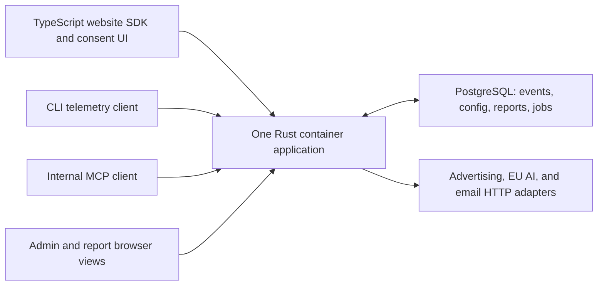

# Implement a portable analytics service on Bunny and PostgreSQL

## Status and planning basis

- Date: 2026-10-20. P1 implementation plan; the TypeScript Package 1 foundation
  exists. The accepted Rust port and live target setup are pending.
- Selected deployment: Bunny Magic Containers, one EU region, initially Frankfurt.
- Selected database: PlanetScale Postgres PS-10 ARM, single node, Frankfurt;
  1 GB RAM, 1/8 vCPU, 10 GB included disk, currently $14/month before taxes.
- Initial forecast: about 1,000 pageviews/day, assumed portfolio-wide for sizing.
- Requirements: [confirmed brief](../discovery/analytics-service-brief.md).
- Product decisions: [scope and priorities](../adr/0004-product-scope-and-priorities.md),
  [observations](../adr/0005-structured-observations.md),
  [privacy/recognition](../adr/0006-privacy-consent-and-recognition.md),
  [lifecycle](../adr/0007-data-lifecycle-and-evidence.md),
  [reports/MCP](../adr/0008-proactive-reports-and-internal-mcp.md), and
  [advertising](../adr/0009-advertising-measurement.md).
- Rationale: [ADR index](../adr/README.md), including the
  [portable container/Postgres decision](../adr/0001-portable-container-and-postgres.md)
  and [Rust backend decision](../adr/0003-rust-backend.md).
- Evidence and pricing: [technical assessment](../discovery/bunny-planetscale-assessment.md).
- Discovery originated in OSS Metrics at `000db1f`; this repository owns the
  service brief, glossary, ADR, and implementation from Package 1 onward.

The service repository is `sebastian-software/analytics-service` (private).
The existing public OSS Metrics API, Rybbit integration, and website remain a
separate application. An owned service domain and production operator setup
remain deployment inputs.

The README describes implemented commands for the TypeScript foundation. The
accepted backend target is now Rust. Complete the W1-R foundation port before
expanding backend product features; the packages below are not evidence of
implemented capabilities. Actual Bunny-to-PS-10 proof requires later provider
provisioning. No paid infrastructure has been created.

## Architecture and portability contract

Ship one Rust application image that serves collection, MCP, admin, and report
routes and runs a background work loop. Use Axum/Tokio for HTTP and execution,
SQLx for PostgreSQL, and the official `rmcp` SDK for MCP. Pin the toolchain,
dependencies, and images during W1-R. Build `linux/amd64` for Bunny; the
database's ARM SKU is independent of the app image architecture.

Use verified PostgreSQL TLS, SQL migrations, and application-owned tables. Check
static SQL against the migrated test schema and verify SQLx offline metadata in
CI. Dynamic queries still need parameterization and real-database checks. No
PlanetScale HTTP API or Bunny SDK is required in business logic. Keep provider
deployment code under `ops/bunny/`.

Keep browser SDK and UI code in TypeScript. Serve compiled admin/report assets
from the Rust app rather than introducing a separate frontend host. Establish
versioned wire contracts and verify generated types against actual JSON behavior.

Keep auth state in Postgres and maintain domain-owned user/workspace permissions.
Select a maintained Rust-compatible login/OAuth integration in W2; the former
Better Auth working choice is withdrawn. Do not implement a custom OAuth
authorization server or treat the MCP SDK as user management. Verify the selected
combination with the intended MCP client. Keep OAuth issuer and report URLs on
an owned domain so a hosting move can preserve their identity.

Create modules as delivered work requires them; the following are proposed
locations in the new repository, not existing paths in OSS Metrics:

| Area | Responsibility |
| --- | --- |
| `src/app/` | Startup, typed configuration, dependency wiring, shutdown. |
| `src/domain/` | Metric units, permission/policy decisions, report contracts. |
| `src/ingestion/` and `sdk/` | Batch validation, deduplication, website/CLI contracts. |
| `src/analytics/` | Parameterized queries, attribution, rollups, dataset revisions. |
| `src/jobs/` and `src/reporting/` | Durable work, reports, notification delivery. |
| `src/http/`, `src/mcp/`, `web/` | Transport adapters and browser views using the same application operations. |
| `src/integrations/` | Postgres, auth, ads, AI, and email integrations. |
| `migrations/`, `ops/`, `test/` | SQL history, provider configuration/runbooks, decisive verification. |

Keep integration-specific code at actual external boundaries. Do not build a
generic database abstraction that pretends every storage engine is equivalent.
The supported initial exit target is another compatible PostgreSQL host.

## Data and access contracts

| Data group | Minimum model and invariant |
| --- | --- |
| Workspaces and projects | Explicit workspace boundary; a project belongs to exactly one workspace. |
| Members and recipients | Domain-owned workspace grants; internal admin/reader access and report-only recipients are distinct. |
| Privacy policies and choices | Versioned operator/purpose policy and permitted processing; refusal is not an analytics identity. |
| Recognition | Project-scoped account/browser/system pseudonyms; method and uncertainty are explicit. |
| Events and exclusions | Stable event IDs, project/workspace, occurrence/receipt times, type, provenance, bounded properties. Original event content is unchanged; exclusions are separate records. |
| Goals and attribution | Explicit business outcomes; 30-day first-touch and last-non-direct rules; estimated links stay estimated. |
| Metrics | Bounded hourly/daily summaries, source watermarks, units, and dataset revisions. Do not sum daily distinct counts into a monthly distinct count. |
| Advertising | Account/campaign IDs, explicit UTM mapping, daily delivery/spend/outcomes, source timezone, ISO currency and exact decimal amounts. |
| Reports | Versioned structured aggregate results, period, source versions, template/model metadata, access grants, identified corrections. |
| Jobs and outbox | Due time, stable work identity, lease, attempts, checkpoint and terminal state; notification identity per report/recipient. |
| Credentials and audit | Encrypted integration credentials with a separately held encryption key; minimal administrative audit without raw event payloads. |

Use workspace/project foreign keys that cannot attach an event to another
workspace's project. Enforce authenticated permissions in application operations
and tenant filtering/RLS in PostgreSQL. Runtime credentials must not own the
schema or bypass RLS. Tenant context is transaction-local, not leaked across
pooled connections. Job claiming must obtain its workspace from trusted stored
work, then use the same scoped operations; use a narrow claiming function or
explicitly scoped worker role rather than bypassing every table policy.

MCP exposes bounded query/filter/grouping tools, not arbitrary SQL execution.
Read and write scopes are separate. Admin and MCP call the same operations,
including optimistic concurrency and audit for configuration edits. Cross-workspace
analysis requires explicit grants for every selected workspace.

Start with a small total connection budget, including auth and worker usage;
five runtime connections and one concurrent background job are proposed defaults
to validate on PS-10. Apply query timeouts and pagination. Add indexes for actual
tenant/time and journey access. Normal tables and bounded expiry jobs are enough
at launch; introduce time partitioning or analytical storage when measurements
justify it.

## Proposed external surface

| Route | Behavior |
| --- | --- |
| `/sdk/analytics.v1.js` | Versioned public browser bundle; immutable caching. |
| `GET /v1/projects/:publicId/config` | Public collection/consent configuration without internal credentials or customer data. |
| `POST /v1/collect` | Bounded, versioned website/CLI batches; durable acknowledgement and deduplication. |
| Application auth routes | Verified email login and maintained OAuth discovery/authorization/token endpoints. |
| `/mcp` | Authenticated standard MCP transport with scoped tools. |
| `/admin` | Internal table search/filtering, configuration CRUD and recorded cleanup. |
| `/reports/:reportId` | Named-recipient browser view; the report URL alone grants no access. |
| `/health/live`, `/health/ready` | Process health; separately, schema/database readiness without sensitive details. |

Public project IDs and shipped CLI write tokens are not credentials for reading
analytics. Origin allowlists/CORS are useful browser controls, not proof that
an event came from a human or a genuine CLI. Keep authenticated server-origin
business events distinguishable from public client observations. Apply bounded
payloads and abuse controls without reusing security signals as visitor profiles.

Proposed ingestion bounds are 100 events and 64 KiB per batch, to validate with
real SDK payloads. A repeated stable ID with the same payload is idempotent;
a conflicting payload is rejected. Return success only after commit. Define
retryable failure and backoff for clients; do not acknowledge dropped writes.
Stop and clear optional collection immediately on refusal/withdrawal, including
queued client events. Five-minute query freshness is measured from service
receipt, while occurrence time remains available for late-event analysis.

## Work packages and completion evidence

Commands are added as their behavior is implemented. W1 establishes the local
foundation; later browser, job, tenant, and full exit checks are not placeholders
that pass without exercising those features.

### W1. Boot the same service locally and on the target platform

Requires: a destination checkout for local foundation work; no ad or AI provider
decisions. Final registry/domain/provider setup is needed for live provisioning,
not for booting the local application.

- Create the service repository, pinned toolchain, Dockerfile and local Compose
  setup with ordinary Postgres. Add typed configuration and separate runtime
  versus migration roles. Use SQL migrations as the schema owner. Match the
  local Postgres major version to the selected cluster and pin it.
- Add health endpoints, bounded connection pooling, release identity and SIGTERM
  drain. Check the real Bunny-to-PlanetScale TLS path with synthetic data.
- Establish the commands below, CI checks and an immutable image artifact.
- Prove the same image starts against plain Postgres without provider SDKs.

Evidence: clean boot and migrations, failed readiness with unavailable DB,
successful readiness after reconnect, clean shutdown, and a synthetic write/read
on the actual PS-10 configuration. `pnpm check`, `pnpm test:integration`, and
`docker compose up --build --wait` must perform the named checks.

### W1-R. Port the foundation to Rust

Requires: the existing TypeScript W1 foundation and accepted ADR 0003. This port
is the next backend step; it does not add collection or other product features.

- Port startup/configuration, SQL migrations and history verification, restricted
  runtime credentials, verified TLS, bounded pooling/timeouts, health checks,
  release identity, and SIGTERM drain to Rust with Axum/Tokio and SQLx.
- Preserve applied migration files and the migration-history contract. Do not
  silently switch an existing database to an incompatible SQLx migration ledger.
- Update container/Compose commands, CI, tests, and operating guides together.
  Retain real PostgreSQL rollback, migration concurrency/history, permission,
  outage/recovery, and container lifecycle checks.
- Add offline query metadata for checked static SQL and verify it against the
  migrated disposable PostgreSQL schema in CI. Build without production access.
- Replace the TypeScript backend and its obsolete backend commands after parity
  is verified. Retain TypeScript only where browser tooling requires it.

Evidence: Rust formatting/linting, unit/integration checks, release build, and
container checks pass for the same foundation contracts. Publish only the exact
tested image. Document actual commands in the README rather than adding passing
placeholders. Live provider and export/restore gates still apply separately.

### W2. Create an isolated workspace and manage its configuration

Requires: W1 and W1-R.

- Implement workspace/project/configuration models, invites and verified email
  login, an internal admin shell, and domain-owned access grants.
- Select a maintained Rust-compatible auth integration, then integrate OAuth/MCP
  authorization, including resource-bound tokens and scoped tools. Use explicit
  client registration policy; enable compatibility paths only
  when the intended client requires them. Verify an actual internal MCP login.
- Provide CRUD for projects, goals, and recipients with recorded edits and
  concurrency conflict handling. Report recipients receive no event/admin access.

Evidence: workspace A cannot read or mutate B through HTTP, MCP, or a reused pooled
connection. A forwarded report URL still requires authorized login. A revoked
recipient is denied. Auth keys and permission data survive export/restore.

### W3. Observe a real website under the selected privacy policy

Requires: W2; this package publishes the shared v1 event/batch contract early.

- Implement config/ingestion endpoints and the small TypeScript browser SDK.
  Capture navigation, section visibility and coalesced active dwell. Use stable
  section/action identifiers; do not copy arbitrary DOM text, form inputs, or
  identifying URL contents. Explicitly instrument successful business outcomes.
- Build the owned purpose/service consent interface. For unresolved policy,
  disable optional recognition/history/advertising; aggregate-only measurement
  also requires the concrete project's collection path to be permitted.
- Add permitted project-specific first-party return recognition. Use authenticated
  account identity only through the agreed app contract. Estimated matching has
  an explicit method/quality release gate, not a hidden fingerprint default.
- Add public bot classification inputs as optional enrichment; preserve unknown
  and suspected states. Internal tests and automated CLI use remain separate.
- Instrument one owned website first and expose its observations in an admin table.

Evidence: repeated batches count once, cross-project injection is rejected,
withdrawal clears queued telemetry, forbidden fields never leave the browser,
and collected events become queryable within five minutes. Refusal and unclassified
traffic are not relabeled as consenting humans. Run integration and browser tests.

### W4. Understand one CLI's actual usage

Requires: W2 and the shared ingest contract from W3; can proceed alongside W3's UI.

- Add a small native HTTP client for a pilot CLI, initially Dalo if its current
  integration fits. Inspect the CLI source before choosing a shared Rust or
  TypeScript package; the protocol is independent of language.
- Record command name/version/platform/outcome/coarse duration under telemetry
  permission. Exclude arguments, paths and project contents. Bound network work
  so analytics failure does not hang the command.
- Derive the project-specific system pseudonym locally. Raw system identity is
  not transmitted. A local reset factor enables resetting without abandoning
  stable derivation; document OS reinstall and cloned/shared environment limits.
- Noninteractive/CI execution needs an explicit applicable operator setting;
  do not turn it on merely because no prompt can be shown. Label automation.

Evidence: opt-out sends nothing; reset changes only the intended project identity;
raw identifiers/arguments never enter requests; retries do not duplicate executions;
collection failure leaves the CLI usable. Verify two representative platforms
before claiming cross-platform system-identity support.

### W5. Survive restarts and enforce the data lifecycle

Requires: W1 and the workspace model/permission contract from W2; SDK completion
is not a prerequisite because synthetic events exercise the behavior.

- Implement due-job discovery, unique work keys, atomic leases, bounded retries
  and checkpoints. Use database state rather than a timer as the work authority.
- Add hourly/daily metric jobs, 90-day detailed-data expiry and 24-month summary/
  report expiry. Job and actor detail copies follow their applicable lifecycle.
- Record exclusions without rewriting event content; recompute affected retained
  metrics and identify report corrections. Do not preserve actor/journey copies
  in long-lived reports. Keep distinct-count algebra correct.
- Implement notification outbox semantics. Use provider idempotency where available;
  do not claim universally exactly-once external email delivery.
- Make restores reapply expiry/exclusion obligations before serving data. Set
  purpose-specific retention for consent evidence, auth and audit before release.

Evidence: kill/restart during aggregation/report preparation, overlap two worker
instances, and retry failed work. Counts and unique reports remain correct;
expired records and prohibited report detail do not reappear after restore.

### W6. Ask useful questions and inspect the supporting evidence

Requires: W2, the W3 ingestion contract and W5 metric/dataset operations.
CLI observations join when W4 is ready; they do not block website analysis.

- Implement scoped MCP queries for trends, pages/sections, goals, journeys,
  sources/campaigns and period comparisons, plus the agreed configuration tools.
- Complete internal tables with search, filters, pagination and recorded
  exclusions/deletions. Use the same permission and mutation operations as MCP.
- Return measurement unit, interval, coverage, source freshness, recognition
  method/uncertainty and dataset revision with analysis results.
- Apply the 30-day attribution models and preserve eligible non-direct history.

Evidence: known synthetic journeys yield expected funnel/attribution results;
unknown windows remain unknown, daily distinct counts are not mis-summed, and
admin filters/MCP agree. An internal operator can trace a reported change to its
supporting data without gaining another workspace's private observations.

**First useful pilot:** W1-W6 on one website and one CLI. This delivers real
collection, consent, internal inspection and questions, before external advertising
approvals or automatic AI reporting are on the critical path. It is not full P1.

### W7. Explain advertising costs and measured outcomes

Requires: W2 credentials/account access and W5 durable imports. Begin platform
access applications early; one provider's approval does not block another.

- Implement read-only Google Ads, Meta/Instagram and LinkedIn reporting adapters
  as separate integration slices using a shared normalized metric contract.
- Store import watermarks, account/campaign IDs, source timezone, currencies,
  revisions and explicit UTM-to-campaign mappings. Handle reimports/corrections.
- Show unmatched campaigns, stale imports and unavailable accounts explicitly;
  do not force names or provider conversion totals into false one-to-one matches.
- Integrate spend/clicks/impressions and first-party outcomes into MCP/admin and
  report inputs. Conversion exports remain P2.

Evidence: fixture tests for each adapter and authorized live read comparisons;
rerunning a date range does not duplicate spend. Missing/expired permissions,
partial pages and mixed currencies cannot silently produce misleading totals.
Current platform access/account approvals are external prerequisites, not assumed.

### W8. Deliver reports without routine dashboard inspection

Requires: W5 and W6. Live AI requires an EU-processing/no-training provider
agreement; live mail requires a verified sender and selected HTTP delivery service.
W7 enriches the pilot and is required for complete advertising-report P1 coverage.

- Build a bounded evidence bundle and project/analysis-scoped AI labels. Remove
  direct identity and identifying payload/URL fields before AI access. Treat
  captured text and model outputs as untrusted; neither controls permissions,
  recipients or external writes. Keep token/cost and query limits explicit.
- Generate weekly internal/monthly customer snapshots containing structured
  aggregate results, charts, comparisons, quality limits and supported actions.
  Store revisions/corrections; never retain individual actor IDs/journey copies
  beyond the detail boundary inside report/model logs.
- Add targeted internal anomaly notices when baseline evidence is sufficient.
  Include the comparison period, magnitude and collection-quality limits;
  deduplicate repeated notices and keep recipient/cadence settings explicit.
- Serve authorized browser reports. Email only a notification/link. Configure
  per-customer approval when requested; otherwise schedule delivery automatically.
  Opening a snapshot reads stored results rather than regenerating model output.
- Invalidate revoked recipient access and make significant measurement gaps
  visible instead of describing them as product trends.

Evidence: login/forwarded-link/revocation cases, timezone/period boundaries,
source outages, model failures, bounded costs and retry/restart delivery cases.
The same stored report remains reproducible except for identified corrections
and lifecycle obligations.

### W9. Rehearse the move, then release in stages

Requires: W1-W6 for the internal pilot; W7-W8 and their external release gates for
full P1. Hosting and database exit rehearsals run before the first live-data pilot.

- Exercise the provider-independent checks below with synthetic source data.
- Deploy one replica in the selected Bunny EU region, use the actual PS-10
  runtime/migration roles, and start with one owned website/CLI.
- Verify private routes cannot be shared through the CDN cache. Cache only public
  SDK/static assets. MCP streams, when used, need reconnects/heartbeats; avoid
  treating a persistent stream as a durable job.
- Observe accepted/rejected events, ingestion-to-query lag, query time, database
  memory/storage, oldest pending job, report failures and source staleness.
- Keep the original OSS Metrics contract and existing consumers untouched.
  Expand only after pilot evidence supports the next source/customer.

Evidence: normal work, restart, DB outage/reconnect, rollback to the preceding
compatible application image, and complete auth/tenant lifecycle checks. Resize
only from measured resource/query pressure, not from the old planning ceiling.

## Verification interface across the Rust port

| Check area | Required proof |
| --- | --- |
| Rust checks | Formatting, linting, focused unit checks, and reproducible release build. |
| Real PostgreSQL integration | Migrations/history, tenant roles, writes, retries, jobs, expiry, and restore cases as those capabilities are added. |
| Container lifecycle | Fresh migration/startup, restricted runtime, readiness during DB outage/recovery, and graceful shutdown. |
| Browser end-to-end | Consent/collection, admin CRUD, and report access with test identities. |
| Portability | Same image, synthetic dump/restore to clean non-PlanetScale Postgres, comparable queries and report/job state. |
| Smoke | Explicit test target: health and release/schema identity; authorized synthetic collection/query once implemented. |

The existing TypeScript W1 commands are `pnpm check`, `pnpm test:integration`,
`pnpm test:container`, and health-only `pnpm smoke`. They remain the runnable path
until W1-R replaces the backend and documents the actual Rust commands. Do not
present planned Rust, browser, or full portability checks as already implemented.

CI uses synthetic data and local Postgres. Production dump/recovery exercises
belong in an approved controlled environment, not a generic public CI runner.
Actual target checks remain separate from local synthetic evidence; no empty
passing tasks stand in for missing checks.

## Starting operating cost

The selected PS-10 single-node database is currently $14/month in Frankfurt.
Add an estimated $2-5 for a small always-running Bunny app and modest traffic:
about $16-19/month for core hosting/database, before taxes. A provisional $25-40
planning envelope includes a small AI/mail reserve; provider contract minimums,
model usage, additional environments, or HA can change it. This is an estimate,
not a verified runtime bill or an approved open-ended spending limit.

## Bunny deployment and day-two operation

1. Build one image from the verified revision; publish to GHCR using immutable
   commit tags and record its digest. Use the same artifact for migrations and run.
2. Keep a sanitized deployment description under `ops/bunny/`: region, image,
   port, health probes, grace period, minimum one running replica, cache rules
   and secret references. Restrict enabled/base regions to the intended EU region;
   scheduled work must not depend on requests waking a zero-replica deployment.
   Keep values out of app business code. No local persistent volume is needed.
3. Keep runtime `DATABASE_URL`, auth/signing keys, integration-encryption key and
   AI/mail credentials in operator-controlled secret storage. `PUBLIC_BASE_URL`
   uses an owned domain. A migration connection and provider deployment key are
   release-time credentials, not ordinary app credentials or browser assets.
4. Run compatible SQL migrations once per release with an exclusive migration
   lock; never let every replica race automatic schema changes on startup.
   Use expand/migrate/contract for changes that affect a running earlier image.
5. Update the deployed immutable image after readiness and synthetic checks.
   On SIGTERM stop new requests/job claims, finish or safely release bounded work,
   close connections and exit within the configured grace period.
6. Document backup retention/recovery expectations, releases, lost/stale data,
   credential rotation, failed jobs, data expiry, resizing and incident ownership.

The official Bunny update action currently documents an account-level API key
and no sub-user support. Keep it in a protected deployment workflow only,
pin third-party actions, and verify available credential scope during setup;
do not invent an app-scoped key or give this key to the runtime. Platform
provisioning and secret creation are implementation-stage actions, not performed
by this planning task.

## Hosting exit runbook contract

- Start the unchanged image on another compatible container host with the same
  runtime configuration, Postgres endpoint and required secret material.
- Confirm health, external integrations, MCP authorization and report access
  through a test route before changing the owned domain.
- Quiesce scheduled work or let existing database leases coordinate the overlap;
  avoid running two uncoordinated schedulers during DNS/routing propagation.
- Switch the owned hostname, verify traffic/jobs, then retire the former runner.
  Keep the prior image/configuration available for application rollback.

## Database exit runbook contract

- Choose a compatible target Postgres version and recreate roles, grants,
  migration ownership and required extensions. Use a direct administrative
  source connection for the export with access to all required tenant rows.
- Rehearse `pg_dump`/`pg_restore` with synthetic source data first. A dump carries
  schema/data, not provider branch/backup history or secret-store keys.
- For the small-service live cutover, pause all writers, including ingestion,
  scheduler, admin/auth mutations and outbox workers. Drain active transactions;
  do not acknowledge writes that will be lost during the move.
- Export, restore, reapply expiry/deletion obligations, and compare row counts,
  metric results/revisions, auth grants, reports and outstanding work.
- Change the connection configuration and test the unchanged app. Keep the old
  database frozen. Resume writes only after validation.
- Before target writes resume, rollback can use the unchanged source. After new
  target writes begin, do not blindly switch back: pause again and transfer new
  state or repair forward. This is a planned cutover, not a zero-downtime promise.
- Copy auth/encryption key material through secret storage, preserve the owned
  issuer domain where possible, and revoke old access after the agreed window.
  Remove obsolete copies under the lifecycle policy.

Logical replication is a later lower-interruption option. It requires its own
DDL/sequence/WAL handling and rehearsal; it is not necessary for the initial
1,000-pageview/day service.

## Release gates and remaining setup decisions

The Rust foundation port can proceed without resolving every later integration.
The affected release package waits when:

- The owned domain and actual provider/bootstrap operator setup are unresolved
  (live W1 setup, not a reason to redesign data collection).
- The selected auth/MCP client combination cannot enforce the intended grants
  (W2); use a maintained compatible integration rather than weakening auth.
- A project's regional/purpose policy, CLI permission or recognition quality has
  not been validated (activate only supported processing in W3/W4).
- An advertising app/account lacks real reporting access (that W7 adapter).
- EU AI processing/no-training terms, mail delivery or named recipients are not
  established (affected W8 live delivery).
- PS-10 measurements miss required behavior or cost assumptions change materially
  (resize recommendation needs an explicit revised operating choice).

P1 is complete only when the confirmed brief, not just the core pilot, is covered.
P2 conversion exports/feature flags and P3 surveys/model-call analytics/external
consent-manager adapters remain later work. Keep statistical experiments, replay,
customer MCP, full tracing and arbitrary warehouse imports outside this plan.

## Source-backed implementation constraints

- [Bunny deployment and image architecture](https://bunny.net/docs/magic-containers/deploy)
- [Bunny health checks](https://bunny.net/docs/magic-containers/health-checks)
- [Bunny shutdown](https://bunny.net/docs/magic-containers/graceful-shutdown)
- [Bunny GitHub Actions deployment](https://bunny.net/docs/magic-containers/deploy-with-github-actions)
- [PlanetScale upgrades](https://planetscale.com/docs/postgres/cluster-configuration/single-node)
- [PlanetScale pricing calculator](https://planetscale.com/pricing?region=eu-central&engine=postgres&architecture=aarch64&replicas=0)
- [PostgreSQL dump/restore contract](https://www.postgresql.org/docs/current/app-pgdump.html)
- [Axum](https://github.com/tokio-rs/axum)
- [SQLx query checking](https://docs.rs/sqlx/latest/sqlx/macro.query.html)
- [SQLx offline metadata](https://github.com/transact-rs/sqlx/blob/main/sqlx-cli/README.md)
- [Official Rust MCP SDK](https://github.com/modelcontextprotocol/rust-sdk)

At execution, revalidate these contracts, pinned library versions, repository
instructions and in-scope working state. Planning commands are not implementation
proof. The local TypeScript W1 foundation is implemented; W1-R ports it to Rust.
Live target proof still requires provider setup. W2 follows after Rust foundation
checks pass and includes the maintained auth selection.
